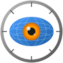
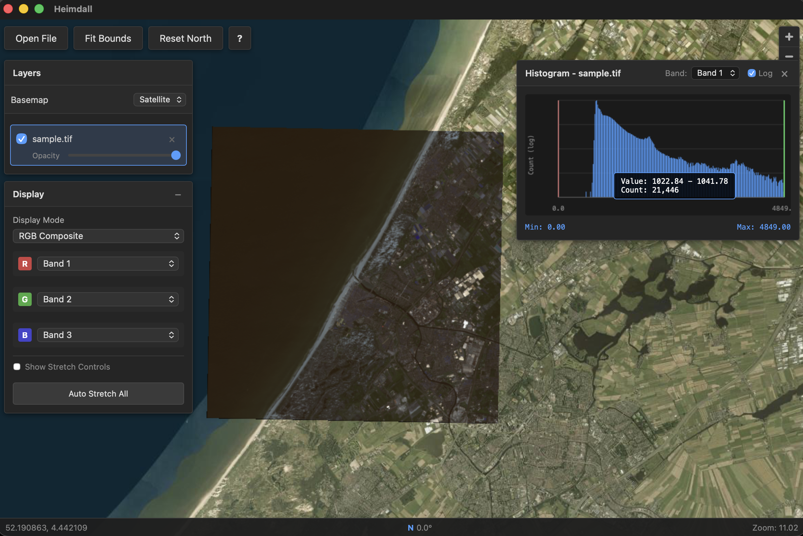

<p align="center">
  
</p>

<h1 align="center">Heimdall</h1>

<p align="center">
  <strong>Fast desktop viewer for geospatial rasters, vectors and satellite imagery.</strong><br>
  Rust + GDAL backend, MapLibre GL frontend, packaged with Tauri. A modern take on OpenEV.
</p>

<p align="center">
  <a href="https://github.com/tapiab/heimdall/actions/workflows/ci.yml"></a>
  <a href="https://github.com/tapiab/heimdall/releases"></a>
  <a href="LICENSE"></a>
  
</p>

<p align="center">
  
</p>

---

## Highlights

- **Open anything GDAL reads.** GeoTIFF/COG, JPEG 2000, NetCDF, HDF5, VRT, plain PNG/JPEG, plus every common vector format.
- **On-the-fly projection.** Rasters are reprojected per tile. Rasters with an **RPC model** (L1 satellite products, `.RPB` / `_RPC.TXT`) are projected through it, optionally against a DEM.
- **Instant display changes.** Raw tiles are cached client-side, so stretch, gamma, colormaps and band math update without going back to the backend.
- **Built-in analysis.** Pixel inspection, multi-band profiles, region statistics, image statistics, histograms.
- **Cloud imagery.** Browse STAC APIs and stream COGs directly.
- **Self-contained.** GDAL, PROJ and their data ship inside the installers.

## Features

<details open>
<summary><strong>Display</strong></summary>

- Multi-layer stack with drag-to-reorder, visibility and opacity
- Grayscale with stretch presets (2–98 %, 1–99 %, min/max, full bit range), gamma and histogram equalization
- 19 colormaps (viridis, magma, turbo, RdBu, terrain, hot, ice, …)
- RGB composites from one file or across several layers, grey-world white balance
- Brightness, contrast, saturation and nearest/linear interpolation, applied on the GPU
- Split view to compare two layers side by side
- 3D terrain with adjustable exaggeration
- Non-georeferenced images shown in pixel coordinates with a grid overlay

</details>

<details>
<summary><strong>Analysis</strong></summary>

- **Pixel inspection.** Value and altitude under the cursor.
- **Value profile.** All bands along a line, with per-band normalisation, map hover marker and CSV export.
- **Region statistics.** Per-band mean, median, σ, SNR, min/max and 2–98 % percentiles for a box, or the spectrum of a single pixel.
- **Image statistics.** Full-resolution band stats, plus column/line charts that flag outlier columns and lines.
- **Band math.** Normalized difference, ratio, difference or a custom expression (`b1..bN`, `+ - * / ^`, `abs sqrt log exp min max`). Save the result as its own layer.
- **Measurement.** Distance measurement and elevation profiles.

</details>

<details>
<summary><strong>Vectors</strong></summary>

- Shapefile, GeoJSON, GeoPackage, KML/KMZ, GML, GPX, FlatGeobuf, MapInfo TAB
- Color by field, fill/stroke styling, feature filters
- Attribute table

</details>

<details>
<summary><strong>Georeferencing</strong></summary>

- RPC projection with per-layer DEM and/or constant height
- Manual GCP georeferencing: polynomial (order 1–3) or thin plate spline, RMS error report, GeoTIFF output

</details>

<details>
<summary><strong>Workflow</strong></summary>

- Projects save layers, display settings, compositions, band math and view (older v1 projects still load)
- Export the view as PNG, high-res 2× PNG, or copy it to the clipboard
- Annotations (markers and labels)
- Location search
- Keyboard-first: every tool has a shortcut

</details>

## Install

Download the latest build from [**Releases**](https://github.com/tapiab/heimdall/releases).

| Platform | Architectures      | Packages                    |
| -------- | ------------------ | --------------------------- |
| macOS    | Apple Silicon, x64 | `.dmg`                      |
| Windows  | x64                | `.msi`, `.exe`              |
| Linux    | x64, arm64         | `.deb`, `.rpm`, `.AppImage` |

> [!NOTE]
> macOS builds are not notarized yet. After installing, clear the quarantine flag once:
>
> ```bash
> xattr -cr /Applications/Heimdall.app
> ```

### Build from source

Requires Node.js 20+, Rust and GDAL with development headers. Full per-platform steps are in [docs/BUILDING.md](docs/BUILDING.md).

```bash
git clone https://github.com/tapiab/heimdall.git
cd heimdall
npm install
make dev          # run the app with hot reload
make tauri-build  # build release installers
make check        # type-check, lint, tests
```

## Keyboard shortcuts

Press <kbd>?</kbd> in the app for the full list.

| File                    |                   | Tools          |                   | View               |                         |
| ----------------------- | ----------------- | -------------- | ----------------- | ------------------ | ----------------------- |
| <kbd>Ctrl+O</kbd>       | Open file(s)      | <kbd>Z</kbd>   | Zoom rectangle    | <kbd>F</kbd>       | Fit to extent           |
| <kbd>Ctrl+S</kbd>       | Save project      | <kbd>M</kbd>   | Measure distance  | <kbd>R</kbd>       | Reset rotation          |
| <kbd>Ctrl+Shift+O</kbd> | Load project      | <kbd>P</kbd>   | Value profile     | <kbd>B</kbd>       | Cycle basemap           |
| <kbd>X</kbd>            | Export PNG        | <kbd>E</kbd>   | Elevation profile | <kbd>T</kbd>       | Toggle 3D terrain       |
| <kbd>Ctrl+Shift+E</kbd> | Export 2× PNG     | <kbd>S</kbd>   | Region statistics | <kbd>L</kbd>       | Layer panel             |
| <kbd>Ctrl+Shift+C</kbd> | Copy to clipboard | <kbd>A</kbd>   | Annotate          | <kbd>D</kbd>       | Display panel           |
|                         |                   | <kbd>G</kbd>   | Georeference      | <kbd>H</kbd>       | Histogram               |
|                         |                   | <kbd>C</kbd>   | STAC browser      | <kbd>V</kbd>       | Toggle layer visibility |
|                         |                   | <kbd>/</kbd>   | Location search   | <kbd>Shift+A</kbd> | Attribute table         |
|                         |                   | <kbd>W</kbd>   | Split view        | <kbd>Del</kbd>     | Remove layer            |
|                         |                   | <kbd>Esc</kbd> | Cancel / close    |                    |                         |

## STAC browser

1. Press <kbd>C</kbd>.
2. Pick Earth Search (AWS), Planetary Computer, or a custom STAC API or static catalog.
3. Filter by area (current view or drawn box), date range and cloud cover.
4. Click footprints to select scenes, then load assets. COGs are streamed with range requests.

## Configuration

Settings live in `~/.config/heimdall/config.json` on every platform. Basemaps can also be edited from the gear icon next to the basemap selector.

```json
{
  "version": "1.0",
  "basemaps": {
    "satellite": {
      "url": "https://tiles.maps.eox.at/wmts/1.0.0/s2cloudless-2021_3857/default/GoogleMapsCompatible/{z}/{y}/{x}.jpg",
      "attribution": "Sentinel-2 cloudless by EOX - CC BY 4.0",
      "name": "Sentinel-2 Cloudless"
    },
    "custom": { "url": "", "attribution": "", "name": "Custom" }
  },
  "stac": {
    "catalogs": [
      {
        "url": "https://earth-search.aws.element84.com/v1",
        "name": "Earth Search (AWS) - Sentinel-2, Landsat"
      },
      {
        "url": "https://planetarycomputer.microsoft.com/api/stac/v1",
        "name": "Planetary Computer - Landsat, NAIP, more"
      }
    ]
  }
}
```

| Key                  | Purpose                                    |
| -------------------- | ------------------------------------------ |
| `basemaps.satellite` | Satellite basemap tile URL and attribution |
| `basemaps.custom`    | User-defined basemap                       |
| `stac.catalogs`      | Catalogs listed in the STAC browser        |

Built-in basemaps: OpenStreetMap, Sentinel-2 Cloudless (10 m), Custom, Pixel Grid (for non-georeferenced images) and None.

## Architecture

```
┌──────────────── Tauri webview ────────────────┐      ┌──────────── Rust backend ────────────┐
│ TypeScript UI · MapLibre GL (WebGL)           │ IPC  │ GDAL dataset pool · per-tile warp    │
│ raw-tile cache → stretch / colormap / band    │◄────►│ RPC & GenImgProj transformers        │
│ math on the client                            │      │ overviews · histograms · STAC/COG    │
└───────────────────────────────────────────────┘      └──────────────────────────────────────┘
```

Details are in [docs/ARCHITECTURE.md](docs/ARCHITECTURE.md).

## Docs

- [Building](docs/BUILDING.md)
- [Testing](docs/TESTING.md)
- [Architecture](docs/ARCHITECTURE.md)
- [Changelog](CHANGELOG.md)
- [Contributing](CONTRIBUTING.md)
- [Code of conduct](CODE_OF_CONDUCT.md)

## Why "Heimdall"?

In Norse mythology, Heimdall is the watchman of the gods. He stands at Bifröst and can see across all nine realms, by day or night. This app does the same job for geospatial data, from continent-wide mosaics down to single pixels.

## License

[Apache 2.0](LICENSE). Third-party notices are in [NOTICE](NOTICE).

Inspired by **OpenEV**, the lightweight viewer that set the bar for fast raster display.
